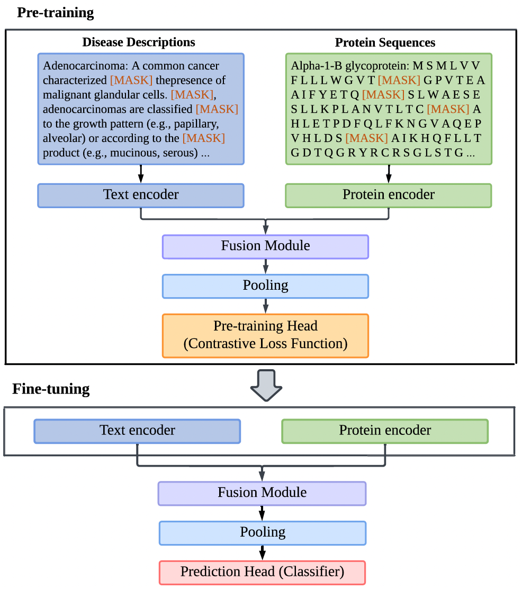

# 🧬 Heterogeneous Biomedical Entity Representation Learning for Gene–Disease Association Prediction

<div align="left">

[](https://academic.oup.com/bib/article/25/5/bbae380/7735275)
[](https://huggingface.co/spaces/Gla-AI4BioMed-Lab/FusionGDA)
[]()

</div>

---
The **FusionGDA** model employs a **contrastive learning–based training strategy** to refine the representations of **genes** and **diseases** derived from pre-trained language models, and further introduces an *attention-based fusion module* to integrate these representations for more accurate **gene–disease association (GDA)** prediction.

---

## 🧩 Framework

<div align="center">
  
</div>

---

## ⚙️ Installation

```bash
# Download and install Anaconda
wget https://repo.anaconda.com/archive/Anaconda3-latest-Linux-x86_64.sh
bash Anaconda3-latest-Linux-x86_64.sh -b
rm Anaconda3-latest-Linux-x86_64.sh
export PATH="/root/anaconda3/bin:$PATH"

# Update Anaconda packages
conda update --all

# Install PyTorch with CUDA support (adjust CUDA version if needed)
conda install pytorch torchvision torchaudio cudatoolkit=11.3 -c pytorch

# Install dependencies
pip install wandb PyTDC lightgbm pytorch-metric-learning
```

---

## 🚀 Execution

Ensure you are in the directory:
```bash
~/dpa_pretrain/scripts
```

Then adjust parameters as required.

### 🔹 Pre-training Phase
```bash
bash run_pretrain_gda_ml_adapter_infoNCE.sh
```

### 🔹 Fine-tuning Phase
**TDC Dataset**
```bash
bash run_finetune_gda_lightgbm_infoNCE_tdc.sh
```

**DisGeNET Dataset**
```bash
bash run_finetune_gda_lightgbm_infoNCE.sh
```

Results can be tracked through your [Weights & Biases](https://wandb.ai) account.

---

## 📊 Datasets

All datasets are obtained from the following public biomedical repositories:  
- **TDC:** [https://tdcommons.ai/](https://tdcommons.ai/)  
- **DisGeNET:** [https://www.disgenet.org/](https://www.disgenet.org/)  

The **specific versions used in our experiments** are stored in the shared Drive:  
👉 [Shared Drive Link](https://gla-my.sharepoint.com/:u:/g/personal/2582280m_student_gla_ac_uk/EejupegKNtFIiyrdb_3B7nYB7RuHgmoxio-IHIwaoyaS2w)

---

## 📝 Citation

If you find **FusionGDA** useful for your research, please cite:

```bibtex
@article{meng2024heterogeneous,
  title={Heterogeneous biomedical entity representation learning for gene-disease association prediction},
  author={Meng, Zhaohan and Liu, Siwei and Liang, Shangsong and Jani, Bhautesh and Meng, Zaiqiao},
  journal={Briefings in Bioinformatics},
  volume={25},
  number={5},
  pages={bbae380},
  year={2024},
  publisher={Oxford University Press}
}
```

---

<div align="center">

🧠 Developed by the **AI4BioMed Lab**,  
School of Computing Science, University of Glasgow, UK 🇬🇧  

</div>
